# Awesome Virtual Event & Breakout Session Management

  

  
  
  
  
  
  

> 🌟 A curated directory of top-tier Virtual Event platforms, Breakout Room tools, and interactive session management software — featuring enterprise SaaS solutions and self-hosted open-source alternatives for hosting online conferences, webinars, digital workshops, and multi-track hybrid events.  
> 🚀 Star this repo if you find it useful! 🚀

---

## 📋 Table of Contents

- [🌐 Sector Overview & Market Dynamics](#-sector-overview--market-dynamics)
- [🏢 SaaS / Hosted Platforms](#-saas--hosted-platforms)
- [🔓 Open-Source Software](#-open-source-software)
  - [Jitsi Meet](#jitsi-meet)
  - [LiveKit](#livekit)
  - [BigBlueButton](#bigbluebutton)
  - [Janus WebRTC Server](#janus-webrtc-server)
  - [Open Event Server](#open-event-server)
  - [pretix](#pretix)
  - [OpenVidu](#openvidu)
  - [eventyay-video](#eventyay-video)
  - [Galène](#galène)
  - [edumeet](#edumeet)
  - [pretalx](#pretalx)
  - [plugNmeet](#plugnmeet)
  - [venueless](#venueless)
  - [PILOS](#pilos)
  - [Open Meet](#open-meet)
- [📊 Comparison at a Glance](#-comparison-at-a-glance)
- [📈 Star History](#-star-history)
- [💖 Support & Sponsorship](#-support--sponsorship)
- [🤝 Contributing](#-contributing)
- [📄 License](#-license)

---

## 🌐 Sector Overview & Market Dynamics

The global virtual events market size was estimated at **$198.7 billion to $243 billion** in 2024–2025 and is projected to expand at a compound annual growth rate (CAGR) of **14% to 18%**, surpassing **$470 billion to $650 billion** by 2030. Rather than conforming to a winner-take-all dynamic, the sector is **highly fragmented**, characterized by enterprise telecom giants (Cisco, Zoom), private equity-backed suites (Cvent, Blackstone), and an extensive ecosystem of modular open-source WebRTC engines serving privacy-conscious universities and developer teams.

---

## 🏢 SaaS / Hosted Platforms

The following table compares the top commercial, hosted virtual event and breakout session management platforms, ordered by company scale (market capitalization / enterprise valuation):

| Product | Company Valuation / Revenue | Starting Price | Free Tier / Trial Limits | Key Focus & Breakout Capabilities |
| :--- | :--- | :--- | :--- | :--- |
| **[Cisco Webex Events](https://www.webex.com/)** | **$235.68B – $304.65B** Market Cap (Cisco Systems, FY24 rev: $53.8B) | **$68.75/month** (promotional entry tier; standard tier starts at $275/organizer/month for 1,000 attendees) | **No free tier & no self-serve free trial** (access requires sales demo consultation; standard Webex Meetings offers 40-min free plan) | End-to-end event experience platform (formerly Socio) supporting multi-session virtual conferences, breakout rooms, badge printing, and mobile event apps. |
| **[Zoom Events](https://zoom.us/events)** | **$19B – $28B** Market Cap (Zoom Video Comms, FY25 rev: $4.67B) | **$1,490/year** ($124.17/month billed annually for 100 attendees; or pay-per-attendee at $125/event for 50 attendees) | **No free plan for Zoom Events** (Zoom Workplace Basic is limited to 40-minute general meetings with breakout rooms; event hubs and multi-session ticketing require paid licensing) | Dedicated event hubs, multi-track conference agenda builders, automated/manual breakout rooms, interactive expo floors, and integrated ticketing. |
| **[Cvent Attendee Hub](https://www.cvent.com/)** | **$4.6B** Enterprise Valuation (Acquired by Blackstone in 2023; 2022 rev: $630.6M) | **$20,000/year** base platform license + ~$7 to $12 per registrant fee | **No free tier & no self-serve free trial** (guided enterprise sandbox demo available upon request; pay-as-you-go ticketing exists for basic registration only) | Comprehensive enterprise event experience combining virtual breakout sessions, mobile attendee apps, live polling, Q&A, and deep Salesforce/CRM integrations. |
| **[Hopin / RingCentral Events](https://www.ringcentral.com/events.html)** | **$7.75B** peak valuation (core assets acquired by RingCentral for up to $50M in 2023) | **$119/organizer/month** billed annually ($1,428/year) for Events Pro plan | **30-day free trial** with access to core organizer admin tools and up to 9 collaborator invites; no permanent free plan | Category-pioneering virtual venue featuring virtual expo halls, stage streaming, speed networking, and interactive breakout rooms. |
| **[ON24](https://www.on24.com/)** | **$347M – $348M** Market Cap ($180M enterprise value; FY24 rev: $148.1M) | **$10,000/year** for baseline commercial entry-level packages | **No free tier & no self-serve free trial** (access granted exclusively via custom corporate sales demos) | Data-driven webinar and virtual event software specializing in audience engagement scoring, customized digital breakout experiences, and conversion analytics. |
| **[Bizzabo](https://www.bizzabo.com/)** | **$200M** Valuation ($226M raised from Insight Partners; estimated ARR: ~$30M) | **$17,999/year** ($499/user/month billed annually with a mandatory 3-user minimum) | **No free tier & no self-serve free trial** (enterprise evaluation exclusively via scheduled platform demo) | Event Experience OS powering in-person, virtual, and hybrid formats with multi-track breakout sessions, wearable smart badges (Klik), and attendee networking. |
| **[Airmeet](https://www.airmeet.com/)** | **$152M** Valuation ($50M venture-backed by Accel & Peak XV; estimated ARR: ~$28M) | **$167/month** billed annually (or $199 month-to-month) for Premium Webinars | **Free-forever plan capped at 50 live attendees**, max 5 events/month, 90 minutes per session, and 1 host seat | Interactive virtual conference tool known for its "Social Lounge" fluid tables, virtual fluid breakout groups, and gamified leaderboards. |
| **[Hubilo](https://www.hubilo.com/)** | **$500M** peak valuation estimate ($153M raised; acquired by Brandlive in 2025) | **$10,000/year** base annual platform contract | **No permanent free tier** (trial sandboxes available on request via sales coordination) | Immersive attendee engagement platform equipped with automated breakout tracks, 1-on-1 attendee matchmaking, and gamification suites. |
| **[vFairs](https://www.vfairs.com/)** | **Bootstrapped** (~$30M ARR; acquired by Brandlive in 2025) | **$5,000/event** (or custom multi-event annual licenses) | **No free tier & no self-serve free trial** (custom interactive guided walkthrough demo upon booking) | 3D visual virtual event environment featuring realistic auditoriums, animated exhibition booths, and moderated group breakout spaces. |

---

## 🔓 Open-Source Software

Self-hosted, community-driven virtual event, breakout room, and real-time conferencing systems. Repositories are ordered by GitHub stargazer count (descending):

### [Jitsi Meet](https://github.com/jitsi/jitsi-meet) 
**Stack:** JavaScript / React / WebRTC | **License:** Apache-2.0  
A battle-tested 100% open-source video conferencing platform with native **breakout room** support. Moderators can create multiple breakout rooms, auto-assign or manually move participants, broadcast messages across sub-rooms, and record sessions.  
- **Best for:** Self-hosters and organizations looking for a zero-cost, scalable alternative to Zoom Meetings with built-in breakout capabilities.

### [LiveKit](https://github.com/livekit/livekit) 
**Stack:** Go / WebRTC / TypeScript / Python | **License:** Apache-2.0  
An ultra-modern, end-to-end real-time WebRTC infrastructure and SFU designed to power interactive virtual events, AI voice assistants, and dynamic multi-room workflows. Developers can programmatically spawn isolated breakout rooms, manage participant permissions, and orchestrate server-side recording and egress streaming.  
- **Best for:** Developers building bespoke virtual event platforms, hackathon systems, and interactive multi-room breakout apps.

### [BigBlueButton](https://github.com/bigbluebutton/bigbluebutton) 
**Stack:** Java / JavaScript / WebRTC | **License:** LGPL-3.0  
The leading open-source web conferencing system purpose-built for online education and workshops, featuring **native breakout rooms** as a headline capability. Features include drag-and-drop room assignments, breakout time limits, shared collaborative whiteboards, multi-user note-taking, and centralized moderator management.  
- **Best for:** Universities, schools, and corporate training programs requiring structured educational breakout spaces.

### [Janus WebRTC Server](https://github.com/meetecho/janus-gateway) 
**Stack:** C / WebRTC | **License:** GPL-3.0  
A general-purpose WebRTC server by Meetecho providing modular plugins for video room routing (SFU), streaming broadcasts, SIP gateway integration, and audio bridging. Powers large-scale virtual event backends requiring high-concurrency room partitioning.  
- **Best for:** Low-level WebRTC architects building custom high-performance virtual meeting backends.

### [Open Event Server](https://github.com/fossasia/open-event-server) 
**Stack:** Python / Flask / SQLAlchemy / PostgreSQL | **License:** GPL-3.0  
The core backend powering FOSSASIA's eventyay. Provides complete event management infrastructure including multi-track conference scheduling, speaker session administration, ticketing, badge generation, and RESTful APIs for video room integrations.  
- **Best for:** Community conferences, summits, and open-source conventions needing full event lifecycle management.

### [pretix](https://github.com/pretix/pretix) 
**Stack:** Python / Django / PostgreSQL / Redis | **License:** Apache-2.0  
An enterprise-ready ticketing and event management ecosystem built for conferences, workshops, and festivals. Offers deep integration with virtual streaming platforms, custom registration workflows, access vouchers, and attendee track permissions.  
- **Best for:** Event organizers requiring independent ticketing and fine-grained access control for private session tracks.

### [OpenVidu](https://github.com/OpenVidu/openvidu) 
**Stack:** Java / TypeScript / WebRTC (LiveKit/Mediasoup backend) | **License:** Apache-2.0  
A developer-friendly platform designed to simplify adding real-time multi-party video conferencing, chat, and breakout rooms into web or mobile apps. Offers full layout customization, automated recording, and scalable cloud deployment scripts.  
- **Best for:** Software engineers adding embedded breakout sessions and video rooms into custom web applications.

### [eventyay-video](https://github.com/fossasia/eventyay-video) 
**Stack:** Python / Django / JavaScript | **License:** Apache-2.0  
FOSSASIA's dedicated open-source virtual conference frontend. Built on top of open event standards, it enables organizers to conduct multi-room online conferences with live video streams, interactive sub-channels, and group chats under a permissive Apache-2.0 license.  
- **Best for:** Organizers looking for a 100% free and open-source virtual event hall with multi-room breakout support.

### [Galène](https://github.com/jech/galene) 
**Stack:** Go / WebRTC | **License:** MIT  
A lightweight, high-performance WebRTC videoconferencing server developed by Juliusz Chroboczek at Université Paris Cité. Designed for lectures and conferences, it easily divides participants into configurable breakout groups and parallel lecture streams with minimal server footprint.  
- **Best for:** Lightweight, resource-efficient self-hosting on modest VPS hardware.

### [edumeet](https://github.com/edumeet/edumeet) 
**Stack:** TypeScript / Node.js / mediasoup / WebRTC | **License:** MIT  
A scalable WebRTC web-conferencing platform originally developed within the pan-European GÉANT research network. Version 4.0 delivers native **breakout rooms**, automated transcriptions, background blur, and a multi-tenant management interface.  
- **Best for:** European academic and scientific institutions demanding GDPR-compliant, privacy-first breakout capabilities.

### [pretalx](https://github.com/pretalx/pretalx) 
**Stack:** Python / Django / JavaScript | **License:** Apache-2.0  
A conference management system tailored for handling Call for Papers (CfP), peer reviews, speaker communications, and multi-track session scheduling. Feeds directly into virtual conference tools like venueless and eventyay.  
- **Best for:** Academic and tech conference organizers needing robust multi-session schedule administration.

### [plugNmeet](https://github.com/mynaparrot/plugNmeet-server) 
**Stack:** Go / React / LiveKit | **License:** MIT  
A modern, open-source video conferencing and webinar solution with **native breakout room** controls. Includes AI-powered translation and meeting summary bots, multi-user whiteboards, surveys, MP4 recordings, and RTMP live streaming to YouTube or Twitch.  
- **Best for:** Teams requiring a turn-key webinar system with AI assistants and breakout capabilities.

### [venueless](https://github.com/venueless/venueless) 
**Stack:** Python / Django / Channels / Vue.js | **License:** BSL 1.1 (converts to Apache-2.0)  
A dedicated virtual event platform crafted by the creators of pretix and pretalx. Built specifically for running digital conferences with live stages, breakout discussion rooms, exhibitor areas, and integrated chat channels.  
- **Best for:** European tech conferences wanting an authentic digital venue experience.

### [PILOS](https://github.com/THM-Health/PILOS) 
**Stack:** PHP / Laravel / Vue.js | **License:** LGPL-2.1  
An open-source management portal and intelligent load balancer for distributed BigBlueButton server pools. Simplifies user permission management, automated room scaling, breakout group scheduling, and RTMP live broadcasts.  
- **Best for:** Universities and institutions managing multi-server BigBlueButton deployments.

### [Open Meet](https://github.com/suraj-kashyap-dev/open-meet) 
**Stack:** TypeScript / Next.js / NestJS / LiveKit | **License:** MIT  
A self-hostable video meeting alternative to Google Meet and Zoom, offering instant room links, persistent chat, screen sharing, and moderator access controls built upon LiveKit.  
- **Best for:** Developers looking for a lightweight, modern full-stack TypeScript template for team calls.

---

## 📊 Comparison at a Glance

| Software | License | Deployment | Native Breakout Rooms | Self-Hosted | Max Capacity | Ideal Use Case |
| :--- | :--- | :--- | :--- | :--- | :--- | :--- |
| **Cisco Webex Events** | Commercial | Cloud SaaS | ✅ Yes | ❌ No | 100,000+ | Large-scale corporate conferences & trade shows |
| **Zoom Events** | Commercial | Cloud SaaS | ✅ Yes | ❌ No | 50,000+ | Multi-session enterprise events in Zoom ecosystem |
| **Cvent Attendee Hub** | Commercial | Cloud SaaS | ✅ Yes | ❌ No | 50,000+ | Global corporate summits & hybrid events |
| **RingCentral Events** | Commercial | Cloud SaaS | ✅ Yes | ❌ No | 100,000+ | Virtual expo floors & community conferences |
| **ON24** | Commercial | Cloud SaaS | ✅ Yes | ❌ No | 25,000+ | Data-driven B2B lead-generation webinars |
| **Bizzabo** | Commercial | Cloud SaaS | ✅ Yes | ❌ No | 20,000+ | B2B user conferences & hybrid event programs |
| **Airmeet** | Commercial (Freemium) | Cloud SaaS | ✅ Yes | ❌ No | 10,000+ | Interactive workshops & networking meetups |
| **Hubilo** | Commercial | Cloud SaaS | ✅ Yes | ❌ No | 15,000+ | Engagement-first virtual seminars & summits |
| **vFairs** | Commercial | Cloud SaaS | ✅ Yes | ❌ No | 20,000+ | Immersive 3D virtual job fairs & trade shows |
| **Jitsi Meet** | Apache-2.0 | Self-Hosted / Cloud | ✅ Yes | ✅ Yes | Unlimited (Hardware-dependent) | Privacy-first team conferences & breakout sessions |
| **LiveKit** | Apache-2.0 | Self-Hosted / Cloud | ✅ Programmable | ✅ Yes | Unlimited (Distributed SFU) | Custom developer video architectures & AI voice agents |
| **BigBlueButton** | LGPL-3.0 | Self-Hosted | ✅ Yes | ✅ Yes | 200–300 per node | Distance learning, classrooms, and academic breakouts |
| **Janus WebRTC** | GPL-3.0 | Self-Hosted | ✅ Programmable | ✅ Yes | Unlimited | Low-latency streaming bridges & custom SFUs |
| **Open Event Server** | GPL-3.0 | Self-Hosted | 🔌 Integrations | ✅ Yes | Database-scale | Full conference schedule, CfP, and ticket system |
| **pretix** | Apache-2.0 | Self-Hosted / Cloud | 🔌 Integrations | ✅ Yes | Database-scale | Ticket shop & attendee access permissions |
| **OpenVidu** | Apache-2.0 | Self-Hosted / Cloud | ✅ Yes | ✅ Yes | Cluster-dependent | Embedded video conferencing & custom breakout rooms |
| **eventyay-video** | Apache-2.0 | Self-Hosted | ✅ Yes | ✅ Yes | Cluster-dependent | Fully open-source multi-room community conferences |
| **Galène** | MIT | Self-Hosted | ✅ Yes | ✅ Yes | High density | Ultra-lightweight academic lectures & sub-groups |
| **edumeet** | MIT | Self-Hosted | ✅ Yes | ✅ Yes | 49+ visible video | Academic research networks & collaborative seminars |
| **pretalx** | Apache-2.0 | Self-Hosted / Cloud | 🔌 Integrations | ✅ Yes | Database-scale | Call for papers, speaker talks, and schedule curation |
| **plugNmeet** | MIT | Self-Hosted | ✅ Yes | ✅ Yes | Cluster-dependent | Turn-key self-hosted webinar rooms with AI bots |
| **venueless** | BSL 1.1 → Apache | Self-Hosted | ✅ Yes | ✅ Yes | Cluster-dependent | Independent developer conferences & digital venues |
| **PILOS** | LGPL-2.1 | Self-Hosted | ✅ Yes | ✅ Yes | Cluster-dependent | Multi-tenant front-end & load balancer for BigBlueButton |
| **Open Meet** | MIT | Self-Hosted | ❌ No | ✅ Yes | Host limits | Modern LiveKit + Next.js team collaboration room |

---

## 📈 Star History

---

## 💖 Support & Sponsorship

Thank you so much for exploring and supporting this curated resource! 🌟  
If you find this repository helpful for your virtual events, software architecture, or community gatherings, please consider:

- ⭐ **Starring** the repository on GitHub
- 🍴 **Forking** it and contributing new tools or corrections
- 📢 **Sharing** it with fellow conference organizers, educators, and developers
- ☕ **Buying a coffee / sponsoring** the project via the [GitHub Sponsors Dashboard](https://github.com/sponsors/ishandutta2007)

---

## 🤝 Contributing

Contributions are warmly encouraged! To suggest a new tool or suggest improvements:

1. 🍴 Fork this repository.
2. 🌿 Create a new descriptive branch (`git checkout -b add-tool-name`).
3. 📝 Add the project to the relevant section adhering to alphabetical or star-count sorting.
4. 🚀 Ensure the repository has active releases within the last 12 months.
5. 📬 Submit a pull request with a succinct explanation of why the tool is beneficial.

---

## 📄 License

This repository and compilation are licensed under [CC0 1.0 Universal](LICENSE) (Public Domain Dedication). All featured products, logos, and software belong to their respective owners.

---

⭐ **If this curated list helps your virtual event planning or development, don't forget to star the repository!** ⭐
